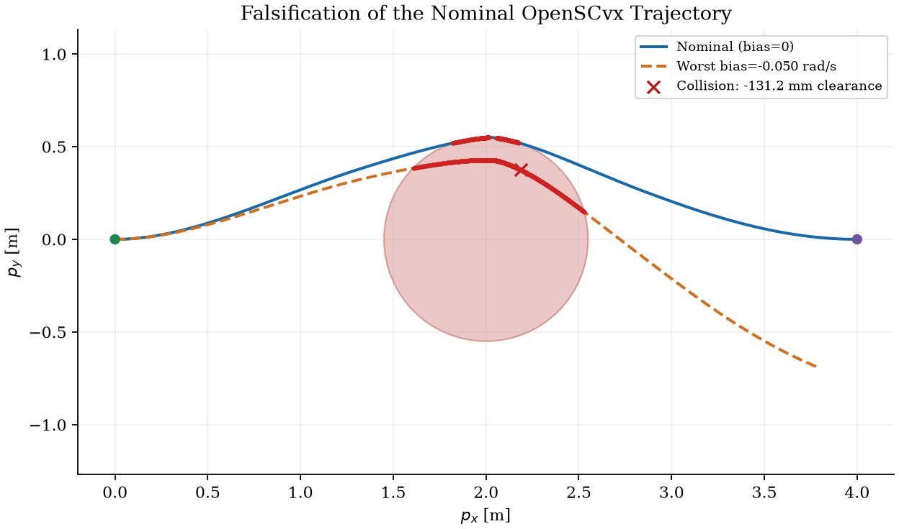
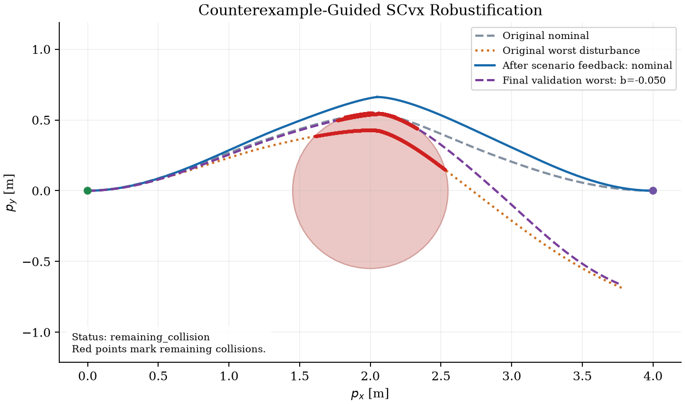
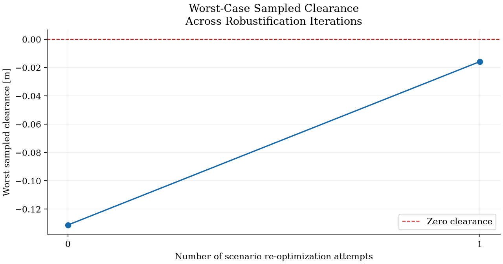

# Counterexample-guided robustification for OpenSCvx

A reproducible experiment extending Fabio's supplied fixed-horizon unicycle
baseline with steering-bias falsification and shared-control scenario feedback.
The original manuscript and baseline are preserved in the sequential Git history.

**Measured outcome: clearance improved, but the repair remains unsafe.** One
counterexample was added and the expanded OpenSCvx problem converged. Independent
validation still finds collision for that retained disturbance. Applied controls
also violate the original speed bounds because of the installed interpolation.
These results do not establish robust feasibility or computational superiority.

## Results

| Metric | Nominal baseline | After scenario feedback |
|---|---:|---:|
| Worst clearance, 501 biases [m] | -0.131208669 | -0.015776418 |
| Geometric path length [m] | 4.181564376 | 4.257311180 |
| Signed distance objective [m] | 4.170100891 | 4.240522450 |
| Nominal terminal pose error norm | 0.000003407 | 0.000012022 |
| Maximum applied speed [m/s] | 1.065051341 | 1.015535350 |
| Minimum applied speed [m/s] | -0.088543511 | -0.108606537 |
| Maximum absolute turn rate [rad/s] | 0.661432321 | 0.752911823 |
| SCvx iterations | 20 | 25 |

Retained biases: `{0, -0.05}` rad/s. One re-optimization attempt. The final nominal
trajectory has 0.083289 m sampled clearance, but the retained -0.05 rad/s trajectory
has -0.015776 m clearance. The final worst collision occurs near 2.205 s at
`(1.912017, 0.526929)` m.

The complete run took approximately 73.0 s on the execution machine: 36.7 s in
independent falsification/validation and 2.0 s in the optimizer loops. Initialization,
JAX compilation, post-processing, and figure generation account for the remainder.
These are single-run timings, not comparative benchmarks.

See [machine-readable results](results/results.json), [quantitative table](results/table.md),
[raw baseline arrays](results/baseline.npz), and [raw expanded-solve arrays](results/iteration_01.npz).
JSON records include convergence flags, CTCS residuals, nodal propagation defects,
terminal errors, control knots, time grids, and component timings. The signed
distance objective differs from geometric length because applied speed briefly
becomes negative.







Vector figures: [Figure 1](results/01_nominal_falsification.pdf),
[Figure 2](results/02_counterexample_robustification.pdf),
[Figure 3](results/03_robustness_iterations.pdf).

## Reproduce on Windows / PowerShell

Install Python 3.12 and `uv`, then run from this repository:

```powershell
uv venv --python 3.12 .venv
uv pip install --python .venv\Scripts\python.exe -r requirements-lock.txt
$env:PYTHONUTF8 = '1'
.venv\Scripts\python.exe -m pytest -q
.venv\Scripts\python.exe -u run_experiment.py --output results
```

The recorded run has **20 passing tests**. The experiment command deliberately
exits with code **1** when the outcome includes a collision, invalid controls, or
solver failure. Read `results/results.json` to distinguish those outcomes from a
program error. Use another output directory to preserve the checked-in results.

On Linux/macOS, substitute `.venv/bin/python` for the Windows Python path.
The recorded experiment was run on Windows, Python 3.12, CPU JAX, OpenSCvx 0.5.2,
and the original default QOCO convex solver. The lock file records the full
environment; reproducing on another platform may require compatible wheel versions.

To execute the supplied baseline directly:

```powershell
$env:PYTHONUTF8 = '1'
$env:MPLBACKEND = 'Agg'
.venv\Scripts\python.exe -u baseline_unicycle.py
```

That file retains Fabio's `text.usetex=True` plotting configuration and requires
an external LaTeX installation for its final figure. On this machine it converged
and printed its diagnostics, then plotting failed because `latex` was absent.
The full experiment calls the same optimization construction and uses Matplotlib
mathtext for figures, without changing the baseline file or solve settings.

## Experiment contract

- Keep N=5, T=8 s, start `(0,0,0)`, nominal goal `(4,0,0)`, the original circular
  obstacle at `(2,0)` with radius 0.55 m, and the original controls and bounds.
- Preserve the original distance state/objective, augmented-Lagrangian settings,
  CTCS squared-ReLU constraints with nodal checks, and Dopri8 discretization.
- Falsify fixed controls using independent SciPy DOP853 integration
  (`rtol=1e-10`, `atol=1e-12`), 101 constant biases, and 4001 time samples.
- Retain a violating bias as separate position/heading states with shared speed
  and turn-rate controls. Fix only nominal terminal pose; disturbed endpoints are free.
- Warm-start optimized controls, nominal states, physical time, time dilation,
  and independently propagated disturbed states.
- Allow at most five re-optimization attempts. Stop on solver failure or sampled
  safety; also stop and report a validation failure if an already retained bias
  still violates safety, rather than adding duplicate constraints indefinitely.
- Validate both before and after using 501 biases and 8001 time samples, including
  between-node evaluations. A finite grid does not certify the continuous uncertainty set.

The disturbance interval `[-0.05, 0.05]` rad/s is an experimental assumption. No
larger uncertainty interval or alternative optimizer is substituted. N=11 and
comparative performance studies have not been run.

## Numerical limitation found in the baseline

The installed OpenSCvx discretization and propagation use normalized interpolation
`beta = local_tau * N` over segments of width `1/(N-1)`. At N=5 the endpoint
factor is 1.25. Thus applied controls can exceed their next knot and violate bounds
despite bounded knots. `u_full` uses a different interpolation; treating it as
the applied independent control sequence would misrepresent this baseline.

The experiment reconstructs the installed signal from the optimization knots,
resolved hold masks, and actual physical time grid. Independent nominal propagation
matches OpenSCvx within about 5 micrometers before and 10 micrometers after feedback.
The baseline also collides at zero bias by approximately 5.7 mm; the observed issue
is not solely disturbance robustness. Solver convergence and small CTCS residuals
are insufficient to declare safety here.

See [API inspection and diagnostics](docs/api-notes.md) for source locations and
[the official Problem API](https://openscvx.github.io/OpenSCvx/v0.5.2/Reference/problem/).
The upstream package is left unchanged. Resolving its interpolation and constraint
accuracy issues is necessary before treating the resulting controls as a feasible
physical repair.

To rebuild the manuscript with Tectonic 0.17.0, run `tectonic main.tex` from
`paper/`. The checked-in PDF was compiled and all eight pages were rendered and
visually inspected. The source uses the research figures from `../results/`.

## Files

- `baseline_unicycle.py`: supplied Fabio baseline, preserved.
- `falsifier.py`: fixed-control independent nonlinear rollouts and bias sweeps.
- `robust_scvx.py`: scenario construction, warm starts, solver capture and diagnostics.
- `run_experiment.py`: outer loop, validation, JSON report, table and figures.
- `tests/`: dynamics, interpolation, sharing, warm starts, collision detection,
  failure reporting, stopping conditions, and timing tests.
- `paper/main.tex`: working manuscript, with measured outcome and build fixes.
- `paper/main.pdf`: compiled working manuscript, including the measured figures.
- `docs/experiment-specification.md`: original supplied experiment instructions.
- `docs/implementation-plan.md`, `docs/progress.md`: approved plan and execution evidence.

The initial baseline was provided by Fabio through the user. Counterexample-guided
planning already exists in the literature, including
[Dawson and Fan (2022)](https://arxiv.org/abs/2203.02038). This repository makes no
algorithmic novelty claim. Original literature references are retained in the manuscript;
their presence is not a comprehensive literature review.
